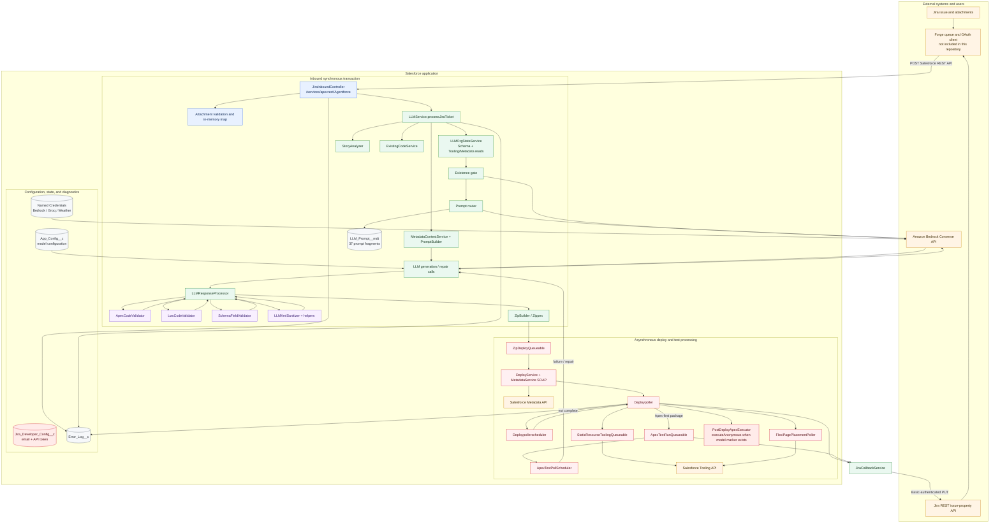
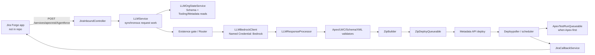

# Repository Audit

Audit date: 2026-09-25  
Scope: checked-in repository only. No Salesforce org, Jira, AWS, Forge, or CI runtime was available. Statements are marked **Confirmed**, **Inferred**, or **Runtime verification required**.

## Executive summary

This is a Salesforce DX proof-of-concept that accepts a Jira issue, gathers Salesforce-org context, asks Amazon Bedrock to generate Salesforce metadata and Apex/LWC source, applies heuristic validation and transformations, deploys the result through the Metadata API, runs selected generated Apex tests, and posts the eventual result back to Jira.

The intended architecture is sophisticated: it has an existence gate, LLM prompt routing, schema-aware validation, packaging, deploy polling, repair loops, and Jira callbacks. The implementation confirms most of that core flow. However, it is **not production-ready**. A cloud access key is committed in source; the REST trigger has no application-level request authentication; LLM work is synchronous before the deploy queue starts; quality gates are broken or absent; and no LWC Jest tests exist.

| Rank | Finding                                                                  | Severity | Evidence                                                                                      |
| ---- | ------------------------------------------------------------------------ | -------: | --------------------------------------------------------------------------------------------- |
| 1    | Committed Bedrock access credential                                      | Critical | `namedCredentials/Bedrock.namedCredential-meta.xml:4`                                         |
| 2    | Jira REST request is not independently authenticated/authorized          |     High | `JiraInboundController.cls:1-39`                                                              |
| 3    | Multiple long LLM calls run synchronously in the REST request            |     High | `LLMService.cls:38-55, 93-149`; `LLMBedrockClient.cls:54,75-95`                               |
| 4    | Ticket/org/generated-code data is logged verbosely                       |     High | `LLMService.cls:32-34,127-155`; `LLMResponseProcessor.cls:1034`                               |
| 5    | No LWC unit tests; standard Jest command fails                           |     High | `npm run test:unit` result: 0 tests                                                           |
| 6    | Lint command does not match project files                                |   Medium | `package.json:scripts.lint`; observed failure                                                 |
| 7    | Jira callback failures are silently accepted                             |   Medium | `JiraCallbackService.cls:51-74`                                                               |
| 8    | Model-supplied post-deploy marker can execute generated Apex anonymously |   Medium | `LLMResponseProcessor.cls:4749-4786`; `PostDeployApexExecutor.cls:26-41`                      |
| 9    | Secrets are modeled as ordinary public hierarchy-setting text fields     |   Medium | `objects/App_Config__c/*.field-meta.xml`; `objects/Jira_Developer_Config__c/*.field-meta.xml` |
| 10   | Manifest references a missing permission set                             |   Medium | `manifest/package.xml:12`; no `permissionsets/` source                                        |

## Repository inventory

### Structure

| Area                             | Contents / purpose                                                                         | Status                              |
| -------------------------------- | ------------------------------------------------------------------------------------------ | ----------------------------------- |
| `force-app/main/default/classes` | 74 Apex classes: 62 production/support classes and 12 test classes                         | Confirmed                           |
| `force-app/main/default/lwc`     | 43 LWC bundles, apparently generated/demo CRM UI components                                | Confirmed; no Jest test files found |
| `objects`                        | `App_Config__c`, `Jira_Developer_Config__c`, `Error_Log__c`, `LLM_Prompt__mdt` and fields  | Confirmed                           |
| `customMetadata`                 | 37 LLM prompt fragments                                                                    | Confirmed                           |
| `namedCredentials`               | Bedrock, Groq API, Weather API                                                             | Confirmed                           |
| `groups`, `labels`, `pages`      | 3 public groups, labels, one Visualforce page                                              | Confirmed                           |
| `manifest/package.xml`           | Minimal, stale-looking selective manifest                                                  | Confirmed                           |
| `scripts`                        | sample SOQL/Apex and a Jest-test downloader                                                | Confirmed                           |
| root documentation               | stock Salesforce README, architecture narrative, test scenarios, previous quality analysis | Confirmed                           |

There are no checked-in triggers, flows, layouts, FlexiPages, permission sets, tabs, assignment-rule files, message channels, profiles, remote-site settings, external credentials, CI workflows, or LWC test files. The architecture document references a Jira Forge application, but that application is explicitly outside this repository.

### Source review catalog

Every production class was reviewed by responsibility and cross-reference. The large generated `MetadataService.cls` (13,278 lines) is a WSDL2Apex binding rather than business logic.

| Subsystem                 | Classes reviewed                                                                                                                                                                                                                                                                                                  | Functionality                                                           |
| ------------------------- | ----------------------------------------------------------------------------------------------------------------------------------------------------------------------------------------------------------------------------------------------------------------------------------------------------------------- | ----------------------------------------------------------------------- |
| Inbound/orchestration     | `JiraInboundController`, `LLMService`, `FunctionHelper`, `ErrorLogger`                                                                                                                                                                                                                                            | REST intake, request lifecycle, deferred DML, errors                    |
| LLM/prompting             | `LLMBedrockClient`, `LLMGroqClient`, `PromptService`, `PromptBuilder`, `PromptContext`, `PromptSection`, `StoryAnalyzer`, `StoryAnalysis`                                                                                                                                                                         | Bedrock request/response normalization, prompt selection, ticket intent |
| Org/context               | `LLMOrgStateService`, `MetadataContextService`, `MetadataContext`, `ExistingCodeService`, `ExistingCodeContext`, `FieldInfo`                                                                                                                                                                                      | Schema, Tooling/Metadata API state, existing-code lookup                |
| Response validation       | `LLMResponseProcessor`, `ApexCodeValidator`, `LwcCodeValidator`, `SchemaFieldValidator`, `LLMXmlSanitizer`, `LLMTriggerMerger`, `LLMLayoutHelper`, `LLMRelationshipHelper`, `ResponseValidator`, DTOs                                                                                                             | Parse/model output, validate, repair, merge and stage metadata          |
| Deployment                | `ZipBuilder`, `Zippex`, `Puff`, `HexUtil`, `ZipDeployQueueable`, `DeployService`, `Deploypoller`, `Deploypollerscheduler`, `MetadataService`, `MetadataPort`                                                                                                                                                      | ZIP construction, Metadata API deployment, asynchronous polling         |
| Test/repair               | `ApexTestRunQueueable`, `ApexTestPollScheduler`, `PostDeployApexExecutor`                                                                                                                                                                                                                                         | Run generated Apex tests, retry generation, post-deploy action          |
| Metadata helpers          | `CustomMetadataHelper`, `CustomSettingHelper`, `PermissionSetHelper`, `ProfileHelper`, `UserHelper`, `PageLayoutHelper`, `FlexiPageHelper`, `FlexiPagePlacementPoller`, `FlexiPagePlacementPollerScheduler`, `StandardValueSetHelper`, `StaticResourceHelper`, `StaticResourceToolingQueueable`, `MetadataHelper` | Generate/manage specialized metadata and Tooling API work               |
| CSV/code-review leftovers | `CsvProcessor`, `AICodeReviewService`, `CodeReviewRequest`, `CodeReviewResult`, `AIFile`, `AIValidationResult`, `GenerationContext`, `GenerationResult`                                                                                                                                                           | CSV handling; disabled legacy LLM review path and data containers       |

## Architecture and confirmed runtime flow

### Complete architecture diagram

Trust-boundary note: the external Forge service, its OAuth configuration, and Jira-side authorization are not present in this repository. The diagram therefore confirms the Salesforce-side wiring only; production security depends on configuration that must be validated at runtime.

1. **Inbound:** `JiraInboundController.handleRequest` deserializes `issueKey`, `summary`, `description`, and Base64 attachments; it validates only that issue key and summary are nonblank (`JiraInboundController.cls:19-39`).
2. **Context and model calls:** `LLMService.processJiraTicket` resets static state, gathers org state, executes an existence-gate call, routes prompts, builds context, and asks the model for generated files (`LLMService.cls:13-149`).
3. **Validation/staging:** `LLMResponseProcessor` processes the response; the validators provide structural checks, but do not constitute a formal policy/allow-list approval system. It stores files in `ZipBuilder` and captures optional post-deploy actions.
4. **Deploy:** `ZipDeployQueueable` builds the ZIP in a separate transaction and `DeployService` starts a Metadata API deployment. `Deploypoller` uses queueable hops then scheduled jobs to poll.
5. **Post-deploy:** Apex-first packages can run generated tests and invoke LLM repair. Successful or failed outcomes are PUT to a Jira issue property using Basic authentication stored in a custom setting.

The deploy/poll portion is asynchronous. The ingress/context/model portion is not. The architecture documentation’s claim that the Jira UI is nonblocking depends on its external Forge queue, which is not reviewable here.

## Capability scope

| Capability                                         | Status                                             | Evidence / limitation                                                                        |
| -------------------------------------------------- | -------------------------------------------------- | -------------------------------------------------------------------------------------------- |
| Receive Jira ticket and attachments                | Implemented                                        | REST endpoint and attachment map in `JiraInboundController`                                  |
| Generate Salesforce metadata from ticket text      | Implemented                                        | `LLMService`, `LLMResponseProcessor`, Bedrock client                                         |
| Prompt routing and reusable prompt fragments       | Implemented                                        | `PromptService`, 37 `LLM_Prompt__mdt` records                                                |
| Detect existing objects/code                       | Partially implemented                              | `ExistingCodeService` selects all Apex classes and only recognizes strict naming conventions |
| Validate generated Apex/LWC/metadata               | Implemented, heuristic                             | validators are textual/structural; no compiler/sandbox approval before production deploy     |
| Deploy metadata and poll                           | Implemented                                        | ZIP, Metadata API, poller classes                                                            |
| Repair generated Apex after test failure           | Implemented in code; runtime verification required | `ApexTestRunQueueable`                                                                       |
| Create/update static resources and CSV-driven work | Implemented                                        | tooling queueable and `CsvProcessor`                                                         |
| Provision access model for deployed output         | Not implemented in source                          | no permission sets/profiles; manifest points to absent permission set                        |
| Jira Forge UI/queue/OAuth                          | Out of scope                                       | explicitly documented as not in this repo                                                    |
| Provider choice between Groq and Bedrock           | Not implemented as configurable                    | `LLMGroqClient` always delegates to Bedrock; legacy Groq config remains                      |
| AI code review stage                               | Disabled/dead path                                 | entire call block is commented in `LLMService.cls:157-213`                                   |

## Findings

| ID    | Severity | Confidence | Finding and evidence                                                                                                                                                                                                                   | Impact / recommendation                                                                                                                                                                                                                                                                                  |
| ----- | -------- | ---------- | -------------------------------------------------------------------------------------------------------------------------------------------------------------------------------------------------------------------------------------- | -------------------------------------------------------------------------------------------------------------------------------------------------------------------------------------------------------------------------------------------------------------------------------------------------------- |
| F-001 | Critical | Confirmed  | An AWS access identifier is committed in `force-app/main/default/namedCredentials/Bedrock.namedCredential-meta.xml:4`.                                                                                                                 | Revoke/rotate the credential immediately, purge it from Git history using the organization’s secret-remediation process, and replace with External Credential/Named Credential principal configuration that contains no long-lived secret in source.                                                     |
| F-002 | High     | Confirmed  | `JiraInboundController` accepts JSON and checks only blank `issueKey`/`summary` (`:19-39`). No signature, shared-secret, replay timestamp, issuer, or ticket authorization check exists.                                               | Any principal able to invoke this REST resource can request expensive, privileged AI deployment actions and potentially overwrite Jira status. Require an integration-only OAuth principal plus HMAC/JWT validation, nonce/timestamp replay protection, issue/project allow-lists, and rate/size limits. |
| F-003 | High     | Confirmed  | `LLMService` makes org-state, existence, router, and generation work inline (`:38-149`); each Bedrock call has a 120-second timeout and up to two immediate 429 retries (`LLMBedrockClient.cls:54,75-95`).                             | The REST transaction can exceed synchronous callout/cumulative request limits before any queueable is created. Persist a request record and enqueue the orchestration, returning HTTP 202 immediately.                                                                                                   |
| F-004 | High     | Confirmed  | Ticket summary/description, serialized org/code context, raw model output and error bodies are debug logged (`LLMService.cls:32-34,127-155`; `LLMResponseProcessor.cls:150,967,1034`; `LLMBedrockClient.cls:87-98`).                   | Jira or org data, generated source, prompts, and provider errors can be exposed through debug logs. Replace with redacted, correlation-ID-based telemetry and an explicit retention/access policy.                                                                                                       |
| F-005 | High     | Confirmed  | There are 43 LWC bundles but no Jest test match. `npm run test:unit` exits 1 with “No tests found.” No tests cover inbound REST, Bedrock/Jira callouts, deployment/polling, or core orchestration.                                     | Regressions in the deployment pipeline cannot be detected locally. Add Jest tests for each LWC plus Apex `HttpCalloutMock` tests for every integration and async path.                                                                                                                                   |
| F-006 | Medium   | Confirmed  | `npm run lint` uses `eslint **/{aura,lwc}/**/*.js`; it failed with “No files matching the pattern.”                                                                                                                                    | The intended lint gate is nonfunctional. Use a quoted cross-platform glob such as `eslint "force-app/main/default/{aura,lwc}/**/*.js"`, then enforce it in CI.                                                                                                                                           |
| F-007 | Medium   | Confirmed  | `JiraCallbackService` logs failed PUT responses and returns normally (`:51-74`). It has no retry, exception, durable outbox, or alert.                                                                                                 | A deployment can finish while Jira remains stale/incorrect without operational visibility. Throw or enqueue a durable retry and monitor terminal failures.                                                                                                                                               |
| F-008 | Medium   | Confirmed  | A generated class can add an `// @AgentforcePostDeploy: Class.method` marker (`LLMResponseProcessor.cls:4749-4786`); after deploy the system performs Tooling API `executeAnonymous` (`PostDeployApexExecutor.cls:26-41`).             | Even though the class name must equal the generated member, model-controlled code can run privileged post-deploy logic. Remove this feature or allow only pre-approved, declaratively registered actions with a strict method allow-list and human approval.                                             |
| F-009 | Medium   | Confirmed  | Jira and legacy Groq secrets are ordinary Text fields on public hierarchy settings; Jira callback reads the running user’s `Jira_Developer_Config__c` record (`JiraCallbackService.cls:2-10`). No permission set metadata is provided. | Field visibility and per-user configuration cannot be assured from source; tokens may be accessible to setup users and configuration can vary by async run-as user. Move secrets to External Credentials/Named Credentials; package least-privilege access controls.                                     |
| F-010 | Medium   | Confirmed  | `manifest/package.xml` names `Car_Manager` permission set, but `force-app/main/default/permissionsets` contains no files.                                                                                                              | Selective manifest deployment will fail or omit intended security configuration. Remove/update the member and generate/package actual permission metadata.                                                                                                                                               |
| F-011 | Medium   | Confirmed  | `ExistingCodeService.loadClasses` selects every `ApexClass` including body with no limit (`ExistingCodeService.cls:35-40`), and `LLMOrgStateService` also retrieves code through Tooling APIs.                                         | Large orgs risk heap, CPU, response-size, and data-exposure failures. Query only relevant classes, paginate, cap/summarize bodies, and use deterministic dependency discovery.                                                                                                                           |
| F-012 | Low      | Confirmed  | Provider names/config are stale: `LLMGroqClient.callGroq` always calls Bedrock (`:9-28`), while Groq named credential/config fields remain.                                                                                            | Operators may configure a provider that is never selected. Rename the facade or implement a real provider strategy; retire unused metadata safely.                                                                                                                                                       |
| F-013 | Low      | Confirmed  | `AICodeReviewService` and DTOs are not in the live path: its invocation is within a commented block in `LLMService.cls:157-213`. `GenerationResult`, `PromptContext`, and `PromptSection` have no confirmed production references.     | Dead/ambiguous code raises maintenance risk. Delete it, or restore it with tests and a documented decision point.                                                                                                                                                                                        |
| F-014 | Low      | Confirmed  | Core classes are very large: `LLMResponseProcessor` 4,439 lines, `LLMXmlSanitizer` 3,883, `LLMOrgStateService` 2,496, `LwcCodeValidator` 2,335.                                                                                        | Text-processing rules are difficult to safely change or test. Split by metadata type/rule family and test each parser with fixtures.                                                                                                                                                                     |

## Security assessment

- **Identity and authorization:** Salesforce authentication for REST may exist at the platform edge, but the application itself validates no Jira origin or message integrity. Runtime verification is required for connected-app scopes, REST class access, integration run-as user, IP restrictions, and permission assignments.
- **Secrets:** F-001 is confirmed. Jira API tokens and legacy Groq API keys are also designed as ordinary custom-setting text values. No secret values are reproduced in this report.
- **Data boundaries:** Ticket text, attachments’ metadata, org state, existing Apex/LWC source and generated artifacts are sent to Bedrock. The code has no visible data classification, field-level minimization, consent, DLP, or per-project policy gate.
- **Generated output:** Validators catch many structural patterns but do not prove semantic safety. The system can deploy metadata and execute model-marked generated Apex using the integration user’s authority.
- **FLS/sharing:** Several core classes use `with sharing`, but many do not declare sharing mode. The pipeline intentionally operates over metadata and Tooling APIs; nevertheless, no packaged permission model demonstrates least privilege.
- **Logging:** `Error_Log__c` stores long error/cause/stack-trace fields and no retention/visibility metadata is included. Verify access, encryption, and purge policy.

## Testing and validation assessment

### Executed checks

| Check                                         | Result                                      |
| --------------------------------------------- | ------------------------------------------- |
| `npm run lint`                                | Failed: ESLint glob found no files.         |
| `npm run test:unit`                           | Failed: 0 Jest tests found.                 |
| `git diff --check` after prompt-file creation | Passed.                                     |
| Salesforce deployment / Apex test run         | Not run: no authenticated org was supplied. |

The 12 Apex test classes primarily test generated-code validation helpers and error logging. They do not cover the inbound endpoint, authentication failure paths, callouts, LLM response parsing end-to-end, deployment, polling, scheduler fallbacks, callback retries, or post-deploy execution. No `HttpCalloutMock` use was found.

Priority test plan:

1. REST request authentication, malformed/oversize attachments, replay and unauthorized project cases.
2. Bedrock 200/429/4xx/5xx/malformed JSON using mocks; assert redaction and bounded retry behavior.
3. Jira callback 2xx/4xx/5xx and durable retry behavior.
4. ZIP/deploy/poller queueable and scheduler transitions under `Test.startTest/stopTest`.
5. Generated-output policy tests: disallowed metadata, destructive changes, post-deploy markers, FLS/security patterns.
6. Jest tests for each LWC’s rendering, events, errors, and Apex/LDS mocks.

## Remediation roadmap

| Priority    | Action                                                                                                                            | Effort |
| ----------- | --------------------------------------------------------------------------------------------------------------------------------- | -----: |
| Immediate   | Revoke and rotate the committed AWS credential; remove historical exposure; adopt secret scanning.                                |      M |
| Immediate   | Disable production deployment and `executeAnonymous` post-deploy actions until source authentication and approval controls exist. |      S |
| Immediate   | Fix ESLint command and establish CI that fails on lint/test/secret-scan results.                                                  |      S |
| Immediate   | Correct or retire `manifest/package.xml` and add actual permission metadata.                                                      |      S |
| Short term  | Make inbound work asynchronous with durable request/status records, idempotency key, rate/size limits, and retry policy.          |      L |
| Short term  | Add signed Jira requests, restricted integration principal, allow-listed Jira projects, and audit records.                        |      M |
| Short term  | Redact logs; enforce retention and locked-down access to error records.                                                           |      M |
| Short term  | Add Apex integration mocks and an LWC Jest suite.                                                                                 |      L |
| Medium term | Replace heuristic all-purpose response processing with allow-listed, typed metadata commands and policy checks.                   |      L |
| Medium term | Split oversized classes; introduce provider abstraction and remove Groq leftovers/dead review code.                               |      L |

## Runtime validation checklist

- Verify credential rotation and that no secret remains in Git history, scratch-org source tracking, or deployed named credentials.
- Verify connected-app scopes, REST class access, OAuth flow, integration user profile/permission sets, IP controls, and API limits.
- Verify Jira configuration availability in every async run-as context and the real retry behavior after Jira outages.
- Run all Apex tests in a disposable scratch/sandbox org, deploy the project, and exercise normal, duplicate, malformed, denied, Bedrock-timeout, deployment-failure, and test-repair tickets.
- Verify Metadata/Tooling API permissions and whether self-callouts using session IDs work in the target org configuration.
- Verify which LWC bundles are intended infrastructure versus previous generated example output; the repository does not establish a clear ownership/lifecycle boundary.
