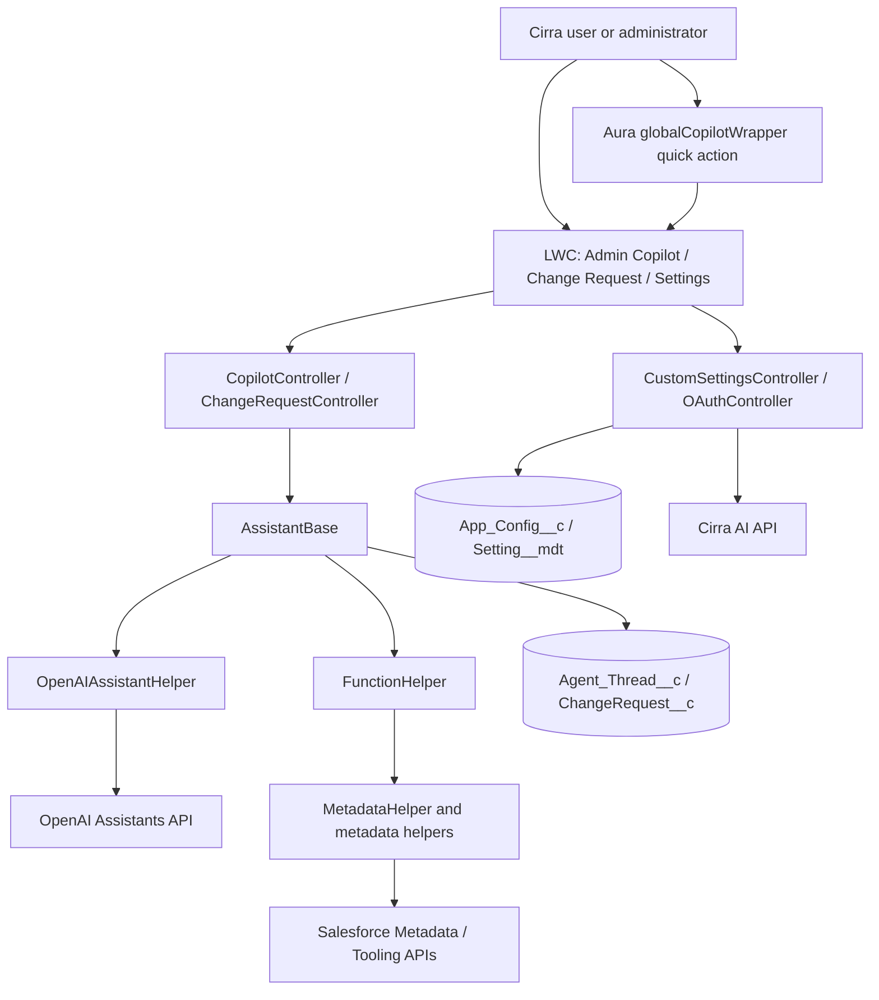
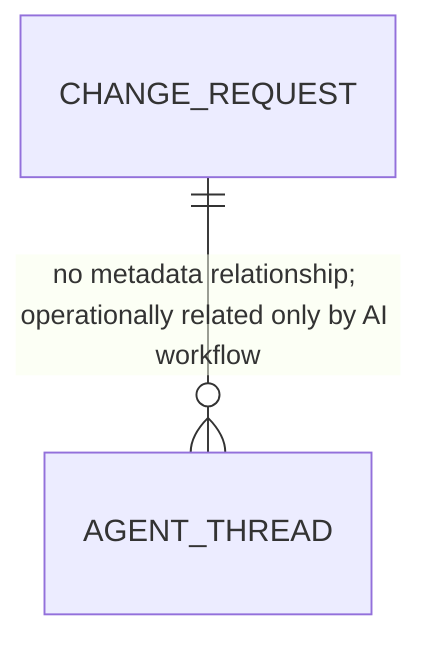
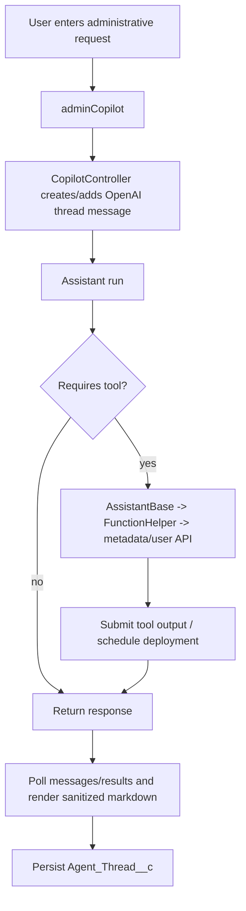

# Salesforce Project Technical Knowledge Transfer

## 1. Executive Summary

**Cirra AI** is a Salesforce DX managed-package project (namespace `Cirra`, API version 60.0) that provides AI-assisted administration of a Salesforce org. The repository supports two confirmed user experiences:

1. **Admin Copilot** — a conversational UI that can inspect and, through explicitly exposed tool functions, change Salesforce metadata and selected user/configuration records.
2. **Change Request** — a record-centric workspace that turns a free-text change request into an AI-generated checklist and action plan, then can execute eligible automated metadata actions.

The package uses Lightning Experience, LWC, one Aura quick-action wrapper, Apex, Salesforce Metadata/Tooling/REST APIs, custom settings/custom metadata, and the OpenAI Assistants API. There are no source-controlled Flows, triggers, platform events, reports, dashboards, Experience Cloud sites, named credentials, external credentials, or CI workflow definitions in this repository.

**Business purpose (implemented evidence):** help Salesforce teams discover, plan, and perform administrative configuration and metadata work. The exact commercial/business process beyond that cannot be fully determined from repository implementation alone.

## 2. Project Purpose

The `Cirra` Lightning app exposes the `AdminCopilot`, `ChangeRequest__c`, and `Settings` tabs. The Admin Copilot offers prompts for object/field work, permission analysis, layouts, users, and Tooling API queries. A Change Request persists its description, AI checklist, and action-item JSON, allowing a user to review, amend, and request execution of an automated task. The Settings UI configures and verifies AI assistant credentials/IDs and a companion Cirra API OAuth handshake.

## 3. Project Scope

### In scope

- Admin chat backed by OpenAI Assistant threads.
- Metadata inspection/modification functions for custom objects and fields, layouts, permission sets, profiles, and selected users.
- Change-request planning and selected automated execution.
- Encrypted package resources/configuration handling, thread persistence, permissions, settings, and OAuth status.

### Out of scope / not identifiable

No declarative record automation, inbound Apex REST endpoint, external-data object, report/dashboard, or Experience Cloud implementation is present. The repository does not establish deployment promotion environments or an external CI service.

### Responsibilities

Salesforce owns the UI, data records, metadata operations, permission checks, orchestration, and calls to external services. OpenAI owns assistant processing/thread-run responses. The `api.cirra.ai` service owns the authentication parameters/ping contract; no implementation of that service is in this repository.

### Personas

- **Cirra AI Administrator**: configuration and broad record access (`Cirra_Admin`).
- **Cirra AI User**: copilot and change-request use under standard record sharing (`Cirra_User`).

## 4. Technology Stack

| Technology                       | Confirmed usage                                               | Evidence                                                             |
| -------------------------------- | ------------------------------------------------------------- | -------------------------------------------------------------------- |
| Salesforce DX / managed packages | Package source, two package definitions                       | `sfdx-project.json`                                                  |
| Apex and SOQL                    | Controllers, helpers, Metadata API orchestration              | `force-app/main/default/classes/`                                    |
| LWC / JS / HTML / CSS            | Main UI and supporting datatable/rendering components         | `lwc/`                                                               |
| Aura                             | Global quick-action wrapper                                   | `aura/globalCopilotWrapper/`                                         |
| Lightning Data Service / UI API  | Reads Change Request fields                                   | `changeRequest.js` (`getRecord`)                                     |
| OpenAI Assistants API v2         | Threads, messages, runs, tool outputs                         | `OpenAIAssistantHelper.cls`                                          |
| HTTP REST callouts               | OpenAI, Cirra API, Salesforce REST/Tooling endpoints          | `RestCalloutHelper.cls`, `OAuthController.cls`, `MetadataHelper.cls` |
| Metadata API                     | Retrieve/update/deploy metadata                               | `MetadataHelper.cls`, `MetadataLayouts.cls`                          |
| Queueable Apex                   | Defers record persistence after metadata deployments          | `AssistantBase.PersistQueueable`                                     |
| Custom setting / custom metadata | App configuration and resource encryption key                 | `App_Config__c`, `Setting__mdt`                                      |
| Static resources                 | encrypted prompts/function definitions; DOMPurify and SheetJS | `staticresources/`, `resources/`                                     |
| Jest / Apex tests                | Unit tests for production classes/components                  | `Test*.cls`, `lwc/**/__tests__`                                      |

## 5. High-Level Architecture



The presentation layer makes imperative Apex calls (apart from LDS and one cacheable settings wire). Controllers specialize an inherited assistant base. `AssistantBase` owns OpenAI thread/run protocol, dynamic function loading, thread persistence, and deferred deployments. `FunctionHelper` is the tool dispatcher’s implementation layer; it delegates metadata operations to `MetadataHelper`, `MetadataLayouts`, `MetadataPermissionSets`, `MetadataProfiles`, and `MetadataUser`.

## 6. Salesforce Architecture Layers

| Layer                       | Actual implementation                                                                                                                        |
| --------------------------- | -------------------------------------------------------------------------------------------------------------------------------------------- |
| Presentation                | Exposed LWCs: `adminCopilot`, `adminCopilotWrapper`, `adminSettings`, `changeRequest`; Aura global action wrapper; Change Request FlexiPage. |
| Controller/orchestration    | `CopilotController`, `ChangeRequestController`, `AssistantBase`.                                                                             |
| Metadata/business functions | `FunctionHelper` and `Metadata*` classes; `Utils`, `Maps`, `Lists`, `Permissions`, `Log`.                                                    |
| Data                        | Custom objects, hierarchy custom setting, custom metadata; Metadata/Tooling API for org configuration.                                       |
| Integration                 | `OpenAIAssistantHelper` + `RestCalloutHelper`; `OAuthController`; Salesforce session-based REST helper.                                      |
| Security                    | permission sets/custom permission, sharing declarations, user-mode query/DML utilities.                                                      |

No trigger-handler, selector/repository, Flow, batch, scheduled, future, Platform Event, or LMS architecture is present.

## 7. Repository Structure

```text
sfdx/
├─ force-app/main/default/
│  ├─ classes/                 Apex production, test, metadata helpers
│  ├─ lwc/                     13 LWC bundles (11 Jest-tested)
│  ├─ aura/globalCopilotWrapper/ Global action host
│  ├─ objects/                 Agent_Thread__c, ChangeRequest__c, App_Config__c, Setting__mdt
│  ├─ permissionsets/          Cirra_Admin, Cirra_User
│  ├─ staticresources/         prompts/functions and third-party browser assets
│  ├─ applications/, tabs/, flexipages/, quickActions/
│  └─ remoteSiteSettings/      OpenAI and Cirra API allow-list entries
├─ resources/                  plaintext prompt/function source used to create encrypted resources
├─ scripts/                    scratch org, packaging, encryption and metadata test scripts
├─ ci/                         shell scripts and PMD configuration (not a pipeline definition)
├─ config/                     scratch-org definition and encryption-key input
└─ unpackaged/                 development MDAPI support/test artifacts
```

`force-app/libs/mdapi` contains generated/third-party Metadata API SOAP classes (`MetadataService`, `MetadataPort`) rather than application domain logic. `unpackaged/mdapi` is auxiliary MDAPI material, not the primary managed-package source.

## 8. Salesforce Data Model



The diagram intentionally shows no foreign key: the source metadata defines **no lookup/master-detail relationships**. The two business objects are independent; Change Request context is held in prompt data, while Agent Thread tracks OpenAI thread state.

| Object             | Purpose                                                                      | Sharing / name                                                                |
| ------------------ | ---------------------------------------------------------------------------- | ----------------------------------------------------------------------------- |
| `ChangeRequest__c` | Requested metadata change, generated checklist/action plan                   | ReadWrite; `CR-{0000}` auto number; activities/history/reports/search enabled |
| `Agent_Thread__c`  | Durable mapping/configuration for an OpenAI thread                           | ReadWrite; `Thread-{0000}`; no activities/reports/search                      |
| `App_Config__c`    | Protected hierarchy custom setting containing per-org AI/Cirra configuration | Hierarchy custom setting                                                      |
| `Setting__mdt`     | Protected custom metadata for package configuration                          | `Value__c` developer-controlled long text                                     |

### Object architecture

**`ChangeRequest__c`** — description says it “documents a requested change to the org metadata.” `ChangeRequest.flexipage-meta.xml` replaces its desktop View action with a record page containing `c:changeRequest`. Its key fields are `Description__c`, `Checklist__c`, and `Actions__c` (all 130,000-character long text). The latter two persist JSON generated/edited by the LWC. There are no record types, validation rules, field relationships, or source-controlled automation.

**`Agent_Thread__c`** — `Thread_ID__c` is required external-ID text (255); `Active_Functions__c` stores serialized function names; `Disable_Load_Functions__c` is a checkbox, default false (label has the shipped typo “Disble”). `AssistantBase` reads/creates/updates this record to resume a known OpenAI thread and its enabled tool set.

**`App_Config__c`** — `API_Base_URL__c` (URL), `API_Key__c`, `Prop1__c`, `Prop2__c`, and `Prop3__c` (text). Field descriptions identify Props 1/2 as assistant IDs and Prop 3 as the temporary OpenAI key location. These must be treated as secret-bearing configuration; values are intentionally not reproduced here.

**`Setting__mdt`** — `Value__c` is long text. The `Setting.Encryption_Key` record supplies the hex key used by `AssistantBase` to decrypt configuration and static resource content. Value: **[REDACTED]**.

## 9. Field Architecture, Record Types, and Configuration

There are no custom record types, picklists, global value sets, dependent picklists, formula fields, roll-ups, validation rules, or custom labels in source.

The `changeRequest` LWC defines its own UI statuses/options and serializes them into the long-text JSON rather than Salesforce picklist metadata. Do not change those JSON shapes casually: `ChangeRequestController.implementChanges` reads action keys such as `type`, `status`, `function`, `parameters`, `details`, `results`, and `links`.

Configuration flow:

```text
Setting__mdt.Encryption_Key -> AssistantBase decrypt/encrypt -> encrypted resources / App_Config__c
App_Config__c.Prop1/Prop2/Prop3 -> controller construction -> OpenAI Assistants API
App_Config__c.API_Base_URL/API_Key -> OAuthController -> Cirra AI API
```

## 10. Apex Architecture

| Class / group                                                                   | Type and responsibility                                                                                               |
| ------------------------------------------------------------------------------- | --------------------------------------------------------------------------------------------------------------------- |
| `AssistantBase`                                                                 | Virtual orchestration base; OpenAI run/tool lifecycle, prompt loading, persisted thread state, Queueable persistence. |
| `CopilotController`                                                             | `with sharing` LWC controller for general administration chat and setup-link results.                                 |
| `ChangeRequestController`                                                       | `with sharing` LWC controller for checklist/action/implementation lifecycle.                                          |
| `OpenAIAssistantHelper`                                                         | inherited-sharing OpenAI Assistants REST client and response validator.                                               |
| `RestCalloutHelper`                                                             | reusable HTTP helper; 60-second timeout and up to three retries for exceptions.                                       |
| `FunctionHelper`                                                                | Tool-function façade; routes allowed assistant function names to metadata/user implementations.                       |
| `MetadataHelper`                                                                | Metadata API/Tooling API conversion, validation, deployment scheduling, retrieval and object/field operations.        |
| `MetadataLayouts`, `MetadataPermissionSets`, `MetadataProfiles`, `MetadataUser` | Specialised metadata/user helpers.                                                                                    |
| `OAuthController`                                                               | Cirra service ping/auth parameter callout and Salesforce authorization URL construction.                              |
| `CustomSettingsController`, `PermissionsController`                             | Settings and permission UI controllers.                                                                               |
| `Permissions`, `Utils`, `Maps`, `Lists`, `Log`, `Constants`                     | Cross-cutting utilities.                                                                                              |
| `RestAPIWrapper`                                                                | Session-ID Salesforce REST client, currently exposes OpenAPI specification retrieval.                                 |

### Important controller methods

| Method                                                               | Caller                      | Function / data effects                                                                                                            |
| -------------------------------------------------------------------- | --------------------------- | ---------------------------------------------------------------------------------------------------------------------------------- |
| `CopilotController.createNewThread`                                  | `adminCopilot`              | Creates OpenAI thread, returns initial `ChatMessage`, finalizes/persists it.                                                       |
| `addMessageToThread`, `retrieveRunResult`, `retrieveNewMessages`     | `adminCopilot` polling loop | Adds a user message, creates/processes run, then polls OpenAI for status/messages.                                                 |
| `ChangeRequestController.createChecklist`                            | `changeRequest`             | Sets in-memory description, creates thread/run from `ChecklistPrompt.md`, finalizes.                                               |
| `createActionItems` / `refactorActionItems`                          | `changeRequest`             | Reads CR, enriches resource prompt with CR fields, creates run.                                                                    |
| `updateChecklist` / `updateActionItems`                              | `changeRequest`             | Selects CR in `WITH USER_MODE`; secure update through `Utils`.                                                                     |
| `implementChanges`                                                   | `changeRequest`             | Validates action index/type/status; activates declared function; submits implementation prompt; finalizes deployments/persistence. |
| `CustomSettingsController.verifySetup`                               | Settings UI                 | verifies encryption, two assistants and Metadata API access.                                                                       |
| `OAuthController.sendPingRequest` / `getAuthorizationCodeRequestUrl` | Settings UI                 | calls Cirra API and returns a Salesforce OAuth authorization-code URL.                                                             |

### Important base/helper methods

`AssistantBase.createRunAndProcessResults` creates an OpenAI run; `processRunResult` applies required tool calls; `callTool` dispatches functions; `callLoadFunctions` enables dynamic function declarations from encrypted static resources and requests a replacement run. `finalize` performs queued metadata deployments, writes deferred records, and upserts Agent Thread state. `FunctionHelper` provides list/describe/create/update/delete functions for custom objects/fields, layouts, permission sets/profiles, users, and Tooling API query/search.

### Apex class documentation

| Class                                         | Called by / calls                                                         | Data, security, and side effects                                                                                                                     |
| --------------------------------------------- | ------------------------------------------------------------------------- | ---------------------------------------------------------------------------------------------------------------------------------------------------- |
| `CopilotController`                           | `adminCopilot`, Aura wrapper; inherits `AssistantBase`                    | `with sharing`; maintains chat thread; its `show_results` function adjusts setup URLs using Tooling field metadata.                                  |
| `ChangeRequestController`                     | `changeRequest`; `AssistantBase`, `Utils`                                 | `with sharing`; reads/updates CR data in user mode/secure DML, builds prompts from CR JSON and can schedule metadata work.                           |
| `AssistantBase`                               | Both controllers; calls OpenAI helper, `FunctionHelper`, `MetadataHelper` | inherited sharing; owns thread lifecycle and persists `Agent_Thread__c`; its nested Queueable persists after metadata jobs.                          |
| `OpenAIAssistantHelper`                       | `AssistantBase`; calls REST helper                                        | inherited sharing; serializes Assistants API requests, deserializes responses and raises `OpenAIException` for API error objects.                    |
| `FunctionHelper`                              | `AssistantBase.callFunction`; calls `Metadata*` classes                   | `with sharing`; exposes the finite function-name-to-operation mapping. It stages records/metadata, rather than taking arbitrary Apex from the model. |
| `MetadataHelper`                              | `FunctionHelper` and specialised metadata helpers                         | inherited sharing; creates/updates/deletes custom object/field metadata, runs Tooling calls, groups/deploys `Metadata.DeployContainer` work.         |
| `MetadataLayouts`                             | `FunctionHelper`; `MetadataHelper`                                        | `with sharing`; retrieves, JSON-patches, creates/clones/deletes layouts and stages asynchronous deployment.                                          |
| `MetadataPermissionSets` / `MetadataProfiles` | `FunctionHelper`                                                          | inherited sharing; describe/patch metadata records. Profile lookup also supports SObject/Tooling query.                                              |
| `MetadataUser`                                | `FunctionHelper`                                                          | inherited sharing; lists/describes/builds User records; persistence is staged through helper logic.                                                  |
| `CustomSettingsController`                    | `adminSettings`; OpenAI/Metadata helpers                                  | `with sharing`; reads/upserts org-default hierarchy setting and validates setup.                                                                     |
| `OAuthController`                             | `adminSettings`; Cirra API                                                | `with sharing`; obtains auth parameters/ping status and forms Salesforce OAuth URL.                                                                  |
| `PermissionsController` / `Permissions`       | `adminSettings`; permission-set query                                     | controller is `with sharing`; `Permissions` is intentionally `without sharing` for assignment checks.                                                |
| `RestCalloutHelper` / `RestAPIWrapper`        | OpenAI, OAuth and metadata clients                                        | HTTP transport with timeout/exception retry; wrapper uses current session ID for Salesforce REST.                                                    |
| `Utils`, `Maps`, `Lists`, `Log`, `Constants`  | Broadly reused                                                            | parameter parsing/normalization, secure DML, JSON helpers, collections, logging, namespace constant.                                                 |

The `Test*.cls` classes are tests, not application runtime components; `force-app/libs/mdapi` classes are generated Metadata API support. No Apex REST resource or invocable method was found.

## 10A. Technical Functionality of the Classes — Main Reference Section

This section describes the **runtime job** of each production class, in the order a developer should read them. It is deliberately implementation-focused: use it to distinguish an orchestration problem, an integration problem, a metadata-operation problem, or a UI/data-access problem when diagnosing another tool.

### AI conversation and orchestration classes

**`AssistantBase.cls` — the central AI workflow engine.** This virtual inherited-sharing class is the common implementation behind both copilots. It is not merely a utility class.

- At construction it loads the encrypted OpenAI key from org-default `App_Config__c`, decrypts it using `Setting__mdt.Encryption_Key`, creates `OpenAIAssistantHelper`, and, for an existing thread, retrieves `Agent_Thread__c` to restore `Active_Functions__c` and `Disable_Load_Functions__c`.
- `createThread`, `addMessageToThread`, `createRun`, and `createRunAndProcessResults` translate Salesforce UI interaction into the OpenAI thread/message/run protocol. Their outputs are `ChatMessage` and `RunResult` DTOs that are safe for the LWC contract—not raw OpenAI response JSON.
- `processRunResult` and `applyRunActions` process statuses and required tool calls. `callTool` handles the OpenAI tool-call envelope; `callFunction` maps the permitted string function name to `FunctionHelper`. A function unknown to the dispatcher is not executed.
- `callLoadFunctions` dynamically reads allowed function declarations from encrypted static resources and stores their names in the thread record. If the set changes, `createNewRunAfterLoadFunctions` cancels/recreates the run so OpenAI receives the new tool definition list.
- `finalize` is the transaction boundary. It asks `MetadataHelper.performDeployments` to submit staged metadata containers, then persists staged sObjects and Agent Thread state. If metadata deployment has been queued, it uses nested `PersistQueueable` so normal record DML is outside the metadata transaction.

**Why this matters as a reference:** the valuable pattern is a stable orchestration layer with a UI DTO contract, persisted correlation/thread state, explicit tool dispatch, and a finalization boundary. It can be adapted for Jira ticket execution without copying the OpenAI-specific parts or changing your tool’s core architecture.

**`CopilotController.cls` — general admin-chat specialization.** It selects the first assistant ID (`Prop1__c` through `getDecryptedConfigValue`) and preload functions `load_functions`/`show_results`. `createNewThread`, `addMessageToThread`, `retrieveRunResult`, and `retrieveNewMessages` are the LWC entry points. Its `showResults` implementation collects result/link maps returned by the model and `fixSetupURL` resolves custom-field setup links via Tooling metadata. `hasGlobalCopilotPermission` supports the Aura quick action. It does not itself contain metadata mutation logic.

**`ChangeRequestController.cls` — controlled plan-to-execution specialization.** It selects the second assistant ID (`Prop2__c`), loads a `ChangeRequest__c`, and forces JSON assistant output. `createChecklist` injects Description into `ChecklistPrompt.md`; `createActionItems` and `refactorActionItems` inject existing CR values into their prompt templates. `updateChecklist`/`updateActionItems` persist user-edited JSON using a user-mode query plus secure DML. `implementChanges` is the important safety gate: it parses `Actions__c`, validates the index, requires `type == automated task` and `status == pending`, then activates only the action’s declared function and builds an execution prompt with the item, function parameters, and prior action results. It appends the CR record during `persistRecords`, ensuring AI-result changes and the thread state are persisted together (or deferred together).

**`OpenAIAssistantHelper.cls` — OpenAI protocol adapter.** It owns endpoint paths and payload formats, not business decisions. `getAssistant` validates configuration; `createThread`, `createMessage`, `createRun`, `retrieveRun`, `listMessages`, `cancelRun`, and `submitToolOutputs` each map to an Assistants v2 API operation. `logAndCheckResponse` detects the API `error` object and raises `OpenAIException`. A Jira equivalent should have one similarly focused adapter that owns Jira REST request/response translation, while ticket rules remain outside it.

**`RestCalloutHelper.cls` — shared transport.** It combines default/request headers, constructs URL paths, sets a 60-second timeout, invokes `Http.send`, retries thrown callout exceptions up to three times, then returns the response body. It does not validate HTTP status codes or deserialize JSON; callers must do that. This separation is useful, but a Jira integration should add explicit status-code handling, idempotency awareness, and safe retry rules for mutating requests.

### Tool dispatcher and Salesforce operation classes

**`FunctionHelper.cls` — allow-listed command façade.** The AI cannot directly execute arbitrary Apex. `AssistantBase.callFunction` selects a specific method in this class; each method extracts/normalizes documented arguments and delegates to a narrower implementation. The class groups operations into: custom objects; fields; page layouts; permission sets; profiles; users; and Tooling API query/search. Mutating layout/profile/permission-set actions return messages that the work was _scheduled_, because metadata deployment is asynchronous. `recordsToPersist` is a staging list consumed by `AssistantBase.finalize`.

**`MetadataHelper.cls` — core Salesforce metadata gateway.** This is the largest technical class. It describes SObjects and fields, validates/create/update/delete custom object/field metadata, turns Metadata API objects into JSON-friendly maps and back, runs Tooling API SOQL/SOSL, and stages/executes `Metadata.DeployContainer` deployments. `performDeployments(threadId)` enqueues every staged container using a callback associated with the originating thread. It also has Metadata API SOAP service/auth helpers and conversion/error-handling routines. This class is where Salesforce metadata semantics belong; it should not be mixed into LWC/controller code.

**`MetadataLayouts.cls` — layout metadata specialist.** It lists/retrieves layouts, converts them to JSON, applies JSON Patch to an existing layout, creates from JSON or cloning, and stages deletion/update/create in deployment containers. It handles namespaces and layout full-name normalization. It is a good example of isolating a complex metadata type behind a small API.

**`MetadataPermissionSets.cls` and `MetadataProfiles.cls` — security-metadata specialists.** Both list/describe metadata and apply JSON patches before sending an update through `MetadataHelper`. `MetadataProfiles` also resolves the mismatch between visible Profile names and metadata full names. They are not runtime sharing enforcement; they administratively modify the org’s security metadata.

**`MetadataUser.cls` — User record builder/reader.** It lists/describes users and resolves a user by ID/name/username/email. It creates or clones a `User` SObject and applies selected template properties; the broader flow stages/persists it. It explicitly requires a Profile ID for one creation path—profile-name lookup is not implemented.

**`RestAPIWrapper.cls` — current-org REST client.** It creates a REST helper whose `Authorization` header is the current Salesforce session ID and currently exposes `getOpenAPIDoc`. Much of the object-describe code is commented out, so do not treat it as a general data API abstraction.

### Setup, permissions, and common utilities

**`CustomSettingsController.cls` — setup configuration facade.** `getCustomSettings` returns the three encrypted values to the LWC; `updateCustomSettings` writes changed values after `verifySetup`. Verification checks that the metadata encryption key is available, decrypts the OpenAI key/assistant IDs, calls `getAssistant` for both assistants, and makes a Metadata API test call. This is the setup-health-check pattern to reuse; the current secret-return behavior is not a pattern to copy.

**`OAuthController.cls` — Cirra service authentication bridge.** It calls the configured Cirra API for a ping and OAuth request parameters, adds org/user headers and API-key bearer authentication, then constructs a Salesforce My Domain authorization-code URL. It does not store tokens or implement the remote service; that is outside this repository.

**`Permissions.cls` and `PermissionsController.cls` — permission assignment check.** `Permissions.hasPermissionSet` queries permission-set assignments under `without sharing`, intentionally allowing a user-context check even when those records are otherwise inaccessible. `PermissionsController.isCirraAdmin` exposes the `Cirra_Admin` check to `adminSettings` and returns false after logging an exception. `CopilotController` separately tests the custom permission for global action visibility.

**`Utils.cls` — boundary and safety utility.** It extracts typed JSON arguments, supports aliases/normalization, resolves namespaces and object/field names, applies JSON Patch, loads/decrypts resources, builds test mocks, and provides secure DML. `updateRecordsSecure` / `upsertRecordsSecure` call `Security.stripInaccessible` and perform DML `as user`; this is the reusable security boundary for user-managed records.

**`Log.cls`, `Maps.cls`, `Lists.cls`, and `Constants.cls` — small cross-cutting helpers.** `Log` provides levelled messages and detailed DML errors. `Maps` supplies emptiness/copy/safe merge/inversion. `Lists` provides empty/deduplicate functions. `Constants` exposes the managed namespace. These keep recurring code out of controllers but contain no business workflow.

### What to reuse conceptually for the Jira–Salesforce tool

Keep your current architecture and compare it against these focused responsibilities rather than transplanting Cirra classes:

| Gap in a Jira–Salesforce ticket execution flow              | Cirra reference pattern                               | Minimal non-architectural improvement                                                                                              |
| ----------------------------------------------------------- | ----------------------------------------------------- | ---------------------------------------------------------------------------------------------------------------------------------- |
| UI repeatedly loses job/ticket state                        | `Agent_Thread__c` correlation/state persistence       | Persist Jira issue key, Salesforce job ID, status, last error, and idempotency key in your existing tracking model.                |
| Controller has HTTP, business rules, and DML mixed together | Controller -> orchestration -> REST adapter -> helper | Extract only the Jira REST client and orchestration service; retain existing UI/controller interfaces.                             |
| Tickets are executed before validation                      | `implementChanges` status/type/function gate          | Validate ticket status, approved action type, required fields, allowed project/operation, and execution state before mutation.     |
| Async action result is unclear                              | `RunResult` plus deployment job IDs/polling           | Return a stable execution DTO with external issue key, Salesforce async job ID, state, user-safe message, and retry guidance.      |
| Retry creates duplicate Jira/Salesforce changes             | staged work + finalization boundary                   | Add idempotency/correlation checks before retrying; retry only transient failures and record outcomes.                             |
| API errors become generic UI failures                       | protocol adapter + typed exception/DTO                | Normalize Jira error body/status into one error contract, log redacted diagnostics, surface a concise toast/status.                |
| Secret/config handling is fragile                           | setup verification (with security caveat)             | Add a verify-connection action, but store credentials server-side using the platform-approved mechanism; never return them to LWC. |

This table is a **reference guide**, not evidence about the Jira tool. A precise bug-and-gap plan requires inspecting that tool’s repository, ticket execution path, integration configuration, logs, and failing test cases.

## 11. Apex Call Graph and Processing Pattern

```text
LWC imperative Apex
  -> CopilotController or ChangeRequestController
  -> AssistantBase
  -> OpenAIAssistantHelper -> RestCalloutHelper -> OpenAI API
  -> required tool call -> FunctionHelper -> Metadata*/MetadataHelper
  -> Metadata API / Tooling API deployment
  -> AssistantBase.finalize -> Agent_Thread__c and (if required) Queueable persistence
```

This is the project’s standard feature path. New assistant-executable behavior requires: a function declaration/documentation resource, dispatch in `AssistantBase.callFunction`, implementation in `FunctionHelper`/a focused helper, appropriate prompt guidance, tests, and a security review. It is not a conventional trigger/service/selector architecture.

## 12. Trigger Architecture and Salesforce Execution Flow

**Implemented:** no `.trigger` or `.flow-meta.xml` files exist. Therefore no project-owned record-save trigger/Flow order is documented. Direct LWC updates call Apex; Apex may invoke metadata deployments and then performs secure DML. Standard Salesforce validation/record-save behavior still applies in the target org, but no project implementation relies on it in source.

## 13. Flow Architecture and Flow-to-Apex Architecture

Not identifiable from the available repository: no Flow metadata and no `@InvocableMethod` production method were found. The closest equivalent orchestration is the OpenAI run/tool loop described above.

## 14. LWC Architecture

| LWC                                                            | Exposure / role                              | Server/data interactions                                                                                            |
| -------------------------------------------------------------- | -------------------------------------------- | ------------------------------------------------------------------------------------------------------------------- |
| `adminCopilot`                                                 | Record/Home/App page; conversational main UI | Imperative `CopilotController`; DOMPurify; polls run/messages; emits result/error events.                           |
| `adminCopilotWrapper`                                          | Home/App/Tab; shell with result area         | Hosts `adminCopilot`, renders markdown result links.                                                                |
| `adminSettings`                                                | Home/App/Tab                                 | Wires `getCustomSettings`; invokes settings, permissions, ping, OAuth methods; uses `refreshApex`.                  |
| `changeRequest`                                                | Record/Home page                             | LDS `getRecord` for three CR fields; imperative Change Request controller calls; SheetJS export; custom datatables. |
| `changeRequestEditPopup`                                       | Internal modal                               | Edits rows and embeds context-specific `adminCopilot`.                                                              |
| `customDatatable`                                              | Internal extension                           | Custom cells/templates for text/status/icon.                                                                        |
| `dynamicTextAreaField`, `readMoreTextAreaStatic`, `lightndown` | Internal rendering/editing                   | text area controls and markdown display.                                                                            |
| `customStatusPill`, `iconCell`                                 | Internal cells                               | `@api status` presentation.                                                                                         |
| `*Constants`                                                   | Internal JS modules                          | UI constants only.                                                                                                  |

Relationships are direct template composition: `adminCopilotWrapper -> adminCopilot, lightndown`; `changeRequest -> dynamicTextAreaField, customDatatable, changeRequestEditPopup`; `changeRequestEditPopup -> dynamicTextAreaField, adminCopilot`; and custom datatable templates -> status/read-more/icon children. Communication uses `@api` properties and `CustomEvent`; no Lightning Message Service/PubSub is present.

### LWC-to-Apex flow

`adminCopilot` initializes an OpenAI thread, sends a user request with contextual information, records the returned run ID, and polls `retrieveRunResult` and `retrieveNewMessages`. `changeRequest` follows the same asynchronous conversation protocol after requesting a checklist/action/implementation, while it uses LDS to refresh the CR fields. `adminSettings` wires configuration but makes update/verification/OAuth calls imperatively. UI errors are generally surfaced using toasts or propagated events.

## 15. Integration Architecture

| System                      | Direction / mechanism                                                              | Authentication and behavior                                                                                           |
| --------------------------- | ---------------------------------------------------------------------------------- | --------------------------------------------------------------------------------------------------------------------- |
| OpenAI Assistants API       | Salesforce -> `https://api.openai.com/v1`                                          | Bearer key from encrypted `App_Config__c.Prop3__c`; `OpenAI-Beta: assistants=v2`; threads/messages/runs/tool outputs. |
| Cirra AI API                | Salesforce -> configured base URL (remote site defaults to `https://api.cirra.ai`) | Bearer `API_Key__c`, user/org headers; ping and OAuth parameters.                                                     |
| Salesforce Metadata API     | Apex -> current org                                                                | Metadata API classes; queued deployments with `Metadata.Operations.enqueueDeployment`.                                |
| Salesforce Tooling/REST API | Apex -> current org                                                                | HTTP calls with current session ID where implemented; metadata lookup/query support.                                  |

The project uses **Remote Site Settings** (`API`, `Cirra_API`) rather than Named Credentials/External Credentials. No inbound service endpoint, OAuth client secret, retry policy for HTTP status codes, or structured persistent integration log is found. `RestCalloutHelper` retries thrown callout exceptions three times; it returns an HTTP body even for an error status, with each client responsible for response validation.

## 16. Authentication, Authorization, and Security

`OAuthController` asks the Cirra API for parameters and builds an authorization-code request URL on the org’s My Domain. `adminSettings` opens it in a browser and later pings the Cirra API. Exact OAuth provider/client implementation is external and not identifiable here.

`Cirra_Admin` grants settings-controller access, modify/view-all for both custom business objects, three CR fields, Agent Thread config fields, app/tabs, and the `Copilot_Global_Action` custom permission. `Cirra_User` grants chat controllers, CRUD (not delete on Agent Thread), CR/Agent Thread field access, tabs/app, and the same custom permission. The Aura wrapper calls `CopilotController.hasGlobalCopilotPermission` before rendering global chat. `Permissions` is deliberately `without sharing` to inspect permission-set assignment; most operational classes are `with sharing` or `inherited sharing`.

### Current implementation

- `ChangeRequestController.selectChangeRequest` uses `WITH USER_MODE`; its updates route through `Utils.updateRecordsSecure`.
- `AssistantBase` persists via `Utils.upsertRecordsSecure`; `Utils` includes user-mode DML paths.
- Several Aura methods carry static-analysis suppressions for FLS. Metadata operations inherently act on org configuration and require elevated capability.

### Confirmed risks and recommendations

- `CustomSettingsController.getCustomSettings` returns the decrypted OpenAI-key value to the client, and the settings component displays/edits it. This is a confirmed secret-exposure risk; redesign to avoid returning secrets and use protected server-side credential storage (for example, Named Credential/external credential where feasible).
- Metadata-changing functions are powerful. Gate the tool/action set by least privilege, explicit confirmation/audit, and an allow-list by user/permission; do not rely solely on prompts.
- Logs may include request/response content (`RestCalloutHelper`, related helpers). Ensure production log levels and redaction prevent credential/prompt leakage.

## 17. Async Apex and Governor Limits

`AssistantBase.PersistQueueable` is the only confirmed async Apex. It runs when metadata deployment jobs have been scheduled, avoiding mixed-DML issues while persisting Agent Thread/other staged records. The metadata deployment itself is asynchronous through `Metadata.Operations.enqueueDeployment`; job IDs return in `RunResult.asyncJobIds`.

There is no batch, scheduled, future, or platform-event processing. Callouts are synchronous in the initiating transaction and need attention to Salesforce callout count/time limits; the helper’s timeout is 60 seconds and each thrown failure can cause up to three attempts. Tool actions can produce one or more metadata containers; `MetadataHelper.performDeployments` stages and enqueues them. Avoid expanding an assistant request into unbounded tool calls or a large number of metadata deployments.

Existing strengths include no trigger-loop DML (there are no triggers), secure list DML helpers, and the asynchronous persistence split. Potential risks are large prompt/resource strings and JSON in long-text fields, serializing metadata, multiple external calls in one interaction, and helper methods using dynamic SOQL/metadata APIs. Tests should cover bulk/staged deployment count and failure cases when extending them.

## 18. Business Process Flows

### Admin copilot



### Change request

```text
User edits Description__c -> changeRequest -> createChecklist -> OpenAI checklist response
-> LWC parses/edits JSON -> updateChecklist -> ChangeRequest__c.Checklist__c
-> createActionItems/refactorActionItems -> Actions__c
-> implementChanges(valid pending automated item) -> selected FunctionHelper operation
-> metadata deployment -> persisted action/thread state -> LWC poll and display.
```

`implementChanges` does not blindly run all suggestions: it rejects an invalid index, non-`automated task`, or non-`pending` action. Its callable function and parameters come from the persisted action JSON, so that field is security-critical input.

## 19. Email, Files, Reports, Dashboards, Experience Cloud

No email templates/alerts, Apex email, custom notifications, Salesforce Files implementation, reports/dashboard metadata, report types, or Experience Cloud site metadata is source-controlled. `ChangeRequest__c` enables reports/history, but no report artifact is supplied.

## 20. Data Access, Error Handling, Logging, and Debugging

Direct SOQL exists chiefly for config, Agent Thread, Change Request, and metadata/user lookup. `MetadataProfiles`/`MetadataUser` use dynamic queries for system metadata/user access; `MetadataHelper` provides Tooling/Metadata API access. No selector/repository/unit-of-work pattern exists.

`OpenAIAssistantHelper` throws `OpenAIException` when response JSON contains `error`. `RestCalloutHelper` retries exceptions and ultimately throws `CalloutException`. Controller entry points either produce chat error DTOs (`createNewThread`, run retrieval) or throw `AuraHandledException` for LWC consumption. `Log` is the project logging façade. For investigation: browser console/toasts for LWC; debug logs for `Log`; OpenAI thread/run IDs in `ChatMessage`/`RunResult`; Agent Thread records for active-function/thread state; deployment job IDs for metadata result; and Remote Site/config values for callout setup.

## 21. Testing Architecture

Sixteen Apex tests cover assistant base, controllers, settings, function helpers, metadata helpers/layouts/profiles/permission sets, OAuth, HTTP helper, permissions, utilities, maps/lists. HTTP behavior is testable through `HttpCalloutMock` and `Utils.useMock`. Eleven LWC Jest suites cover the exposed and internal components. `package.json` supplies `npm run test:unit`, ESLint, Prettier, and coverage commands; `ci/scripts/unit-tests.sh` runs `sf apex run test --code-coverage`. No coverage percentage is stored.

## 22. Deployment Architecture

The repository is Salesforce DX source for a managed package. `sfdx-project.json` contains package definitions for `Cirra AI` (default) and `Cirra-beta`; source API version is 60.0. `scripts/package-version-create.sh` uses `sf package version create --code-coverage`; `scripts/scratch-org-create.sh` creates a 30-day Developer scratch org, encrypts resources, deploys package/dev source, assigns `Cirra_Admin`, and runs `scripts/apex/init-config.apex`.

`config/project-scratch-def.json` enables Author Apex, Person Accounts, Chatter, territory management, account/opportunity teams and Lightning desktop. `ci/scripts` contains deploy/test/coverage helpers and `ci/pmd.xml`, but no GitHub Actions, Azure DevOps, Jenkinsfile, or declared production promotion pipeline exists.

Deploy `objects`, fields, permission sets, custom permission, static resources, Apex, LWCs/Aura, application/tabs, FlexiPage, Quick Action, Remote Site Settings, and configuration metadata together as relevant. The encryption replacement declared in `sfdx-project.json` substitutes the encryption-key marker from `config/encryption-key.txt`; never commit or document its actual value.

## 23. Metadata Dependency Map

```text
Admin Copilot LWC -> CopilotController -> AssistantBase -> prompts/functions static resources
                         -> App_Config__c + Setting__mdt -> OpenAI API
                         -> FunctionHelper -> MetadataHelper -> Metadata API

Change Request FlexiPage -> changeRequest LWC -> ChangeRequestController
                         -> ChangeRequest__c fields + AssistantBase/resources

Global action -> Aura wrapper -> custom permission -> CopilotController -> adminCopilot
```

For a new function, deploy its resource declaration/documentation, implementation, dispatcher routing, prompt references, tests, and any affected permission/configuration components atomically. For a CR UI field change, deploy object field metadata, FLS in both permission sets, LWC schema imports/UI, controller query/update logic, layouts/FlexiPage as needed, and tests.

## 24. Feature-to-Code Traceability

| Feature                   | Object                                | LWC/Aura                             | Apex                                     | External / metadata                 |
| ------------------------- | ------------------------------------- | ------------------------------------ | ---------------------------------------- | ----------------------------------- |
| General admin chat        | `Agent_Thread__c`                     | `adminCopilot`, wrapper, Aura action | `CopilotController`, `AssistantBase`     | OpenAI; Function/Metadata helpers   |
| Change planning/execution | `ChangeRequest__c`, `Agent_Thread__c` | `changeRequest`, popup, datatable    | `ChangeRequestController`                | OpenAI; declared metadata functions |
| Setup/health              | `App_Config__c`, `Setting__mdt`       | `adminSettings`                      | Settings, OAuth, Permissions controllers | OpenAI, Cirra API, Metadata API     |
| Org metadata operations   | Org metadata                          | Copilot result UI                    | `FunctionHelper`, `Metadata*`            | Metadata/Tooling APIs               |

## 25. Change Impact Guide — Where Do I Make the Change?

| Requirement                   | Primary change locations                                                                                  | Check as well                                          |
| ----------------------------- | --------------------------------------------------------------------------------------------------------- | ------------------------------------------------------ |
| Change chat behavior/UI       | `lwc/adminCopilot/`, wrapper/popup                                                                        | controller DTOs/events, Jest                           |
| Add/change metadata operation | function JSON/MD under `resources/functions`, `AssistantBase.callFunction`, `FunctionHelper`, `Metadata*` | prompts, security, deployment/result tests             |
| Change CR lifecycle or JSON   | `changeRequest`, `changeRequestEditPopup`, `ChangeRequestController`                                      | object fields/FLS, constants, tests                    |
| Change credentials/auth       | `adminSettings`, `CustomSettingsController`, `OAuthController`, `App_Config__c`                           | never expose a secret; remote-site allow list          |
| Change user access            | `permissionsets/*.permissionset-meta.xml`, custom permission                                              | Aura visibility, Apex class access and FLS             |
| Change layout/app navigation  | FlexiPage, app, tabs, quick action metadata                                                               | LWC exposure targets and permission-set tab visibility |

## 26. Troubleshooting Guide

| Symptom                             | Investigate                                                  | Likely cause                                                                            |
| ----------------------------------- | ------------------------------------------------------------ | --------------------------------------------------------------------------------------- |
| Copilot cannot start / thread error | Settings Verify, debug log, `Agent_Thread__c`                | bad encrypted key/assistant ID, OpenAI remote-site/callout issue, missing thread record |
| Copilot remains processing          | returned run ID; `retrieveRunResult`; OpenAI run status      | queued/in-progress/requires-action run or tool failure                                  |
| Metadata change did not appear      | `RunResult.asyncJobIds`, setup deployment status, logs       | metadata deployment failed or remains asynchronous                                      |
| Change Request cannot save/read     | CR sharing, `Cirra_User`/`Cirra_Admin` FLS, user-mode error  | missing object/field access or record sharing                                           |
| Settings shows unauthenticated      | `OAuthController.sendPingRequest`, API base/key, remote site | Cirra API config/auth issue                                                             |
| Global action says no access        | `Copilot_Global_Action`, permission-set assignment           | custom permission not assigned                                                          |
| LWC rendering/security issue        | browser console, DOMPurify resource, Jest                    | static resource loading or client parsing/display failure                               |

## 27. Important Files and Design Patterns

| File                                  | Why it matters                                         |
| ------------------------------------- | ------------------------------------------------------ |
| `classes/AssistantBase.cls`           | shared AI orchestration, tool dispatch and persistence |
| `classes/ChangeRequestController.cls` | canonical planning-to-execution server lifecycle       |
| `classes/MetadataHelper.cls`          | core metadata/Tooling/deployment behavior              |
| `lwc/changeRequest/changeRequest.js`  | CR JSON state, LDS and action UI                       |
| `lwc/adminCopilot/adminCopilot.js`    | thread/polling chat UX                                 |
| `objects/*.object-meta.xml`           | supported local data model                             |
| `permissionsets/*.xml`                | shipped access model                                   |
| `scripts/scratch-org-create.sh`       | authoritative local setup sequence                     |

Actual patterns: virtual base-controller specialization (`AssistantBase` -> two controllers), façade/dispatcher (`FunctionHelper`), adapter/client (`RestCalloutHelper`, `OpenAIAssistantHelper`), helper-oriented Metadata API layer, DTO/wrapper (`ChatMessage`, `RunResult`), and Queueable persistence. A classic trigger handler/service/selector pattern is not used.

## 28. Technical Debt and Risks

### Confirmed

- Client-returned secret configuration in `CustomSettingsController` (security risk).
- Direct Remote Site + manual Bearer-header authentication instead of credential metadata.
- Configuration fields named `Prop1__c`/`Prop2__c`/`Prop3__c` reduce maintainability.
- `adminSettings` attempts `refreshApex(this.wiredSettingsResult)`, but its wired callback does not assign that property; refresh may not work as intended.
- `OAuthController.sendRequest` constructs `baseURL` after declaring `baseUrl`; the differing case visible in source is a likely compile/logic defect unless another symbol exists.

### Potential risks

AI-generated action JSON is high-privilege input; tool authorization/validation needs defense in depth. Long-text JSON/prompt operations and sequential external calls may approach heap, CPU, callout, or timeout limits for large requests. Metadata work can affect components outside the managed namespace, as the package-creation script explicitly warns.

### Recommendations

Use protected credential management; remove secret round trips; add auditable confirmation/authorization for mutating tools; introduce structured integration/deployment logs; establish a CI pipeline; and add negative/security/bulk tests around function execution and action JSON.

## 29. Developer Onboarding Guide

1. Read this document, then `sfdx-project.json` and `README.md`.
2. Study the four-object data/config model and permission sets.
3. Trace `adminCopilot -> CopilotController -> AssistantBase`.
4. Trace `changeRequest -> ChangeRequestController.implementChanges -> FunctionHelper`.
5. Read a single function declaration under `resources/functions` alongside its `FunctionHelper` implementation.
6. Run `scripts/scratch-org-create.sh` from `scripts` after Dev Hub authentication; use an approved secret setup process.
7. Run Apex tests and `npm run test:unit`; test metadata changes in a scratch org.

## 30. End-to-End Canonical Flow

The most complete repository-backed flow is a pending automated Change Request action:

```text
User opens Change Request FlexiPage
-> c:changeRequest reads Description/Checklist/Actions through LDS
-> user requests action generation or chooses Implement
-> ChangeRequestController selects CR WITH USER_MODE
-> AssistantBase creates OpenAI thread/run with enriched encrypted prompt
-> OpenAI requests a declared function
-> AssistantBase.callFunction -> FunctionHelper -> MetadataHelper/MetadataLayouts/etc.
-> Metadata.Operations.enqueueDeployment
-> AssistantBase.finalize persists Agent_Thread__c and CR via Queueable when required
-> c:changeRequest polls retrieveRunResult/retrieveNewMessages
-> UI updates JSON-backed tables and reports deployment/run results.
```

## 31. Quick Reference

| Main item         | Reference                                                                                           |
| ----------------- | --------------------------------------------------------------------------------------------------- |
| Main objects      | `ChangeRequest__c`, `Agent_Thread__c`, `App_Config__c`, `Setting__mdt`                              |
| Main Apex         | `AssistantBase`, `CopilotController`, `ChangeRequestController`, `FunctionHelper`, `MetadataHelper` |
| Main LWCs         | `adminCopilot`, `changeRequest`, `adminSettings`                                                    |
| Main integrations | OpenAI Assistants API; Cirra AI API; Salesforce Metadata/Tooling/REST APIs                          |
| Main security     | `Cirra_Admin`, `Cirra_User`, `Copilot_Global_Action`                                                |
| Automation        | Apex-driven assistant/tool orchestration and Queueable persistence; no Flows/triggers               |

## 32. Final System Summary

Cirra AI is an AI-enabled Salesforce administration package. A Lightning user interacts through chat, settings, or a Change Request record. LWCs call sharing-aware Apex controllers, which reuse `AssistantBase` to maintain OpenAI threads, invoke declared tool functions, and persist conversation/tool state. Tool functions interact with the current Salesforce org’s metadata/user APIs and schedule metadata deployments; the package defers record persistence when needed to avoid mixed-DML conflicts. The package’s operational center is not record-trigger automation but the controlled transition from AI response to declared function to Salesforce metadata deployment. Secure credential handling, permission assignment, function-level authorization, and deployment-job observability are therefore the most important maintenance concerns.
